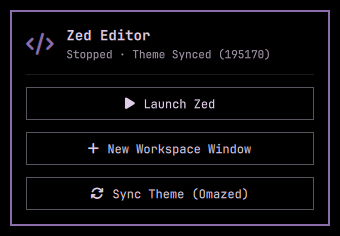

# Zed Integration for Omarchy

Zed Editor launcher, window switcher, and live Omarchy theme synchronization widget for the Omarchy status bar on Hyprland.



## Features

- **Interactive Bar Widget** — Minimalist code icon (`</>`) that highlights when Zed is running and shows active Omarchy & Zed theme sync status in the hover tooltip.
- **Smart Click Actions** — Left-click focuses the running Zed window (`dev.zed.Zed`) or launches Zed if stopped; middle-click opens a new Zed workspace window (`zeditor --new`); right-click opens the quick-action popup card.
- **Live Theme Synchronization** — Displays the current Omarchy theme name alongside Zed's active theme status (`Synced` when `omazed` is configured in `~/.config/zed/settings.json`) and provides a one-click **Sync Theme** button via `omazed sync`.
- **Keyboard & IPC Driven** — Built on Omarchy's `KeyboardPanel` and `ShellIpc` so every action can also be bound to Hyprland keybindings.

## Requirements

- Omarchy 4 (Quattro) or later (`omarchy-shell`) on Hyprland (`hyprctl`, `uwsm-app`)
- [Zed Editor](https://zed.dev/) (`zeditor` / `dev.zed.Zed`)
- `jq` (used by [zed-status.sh](zed-status.sh) to inspect `~/.config/zed/settings.json`)
- `omazed` (for **Sync Theme** / live Omarchy-to-Zed palette syncing)

## Install

```bash
omarchy plugin add https://github.com/codesdilkhush/omarchy-zed --enable
```

To move the widget to another bar section:

```bash
omarchy bar move codesdilkhush.zed --section center
```

## Uninstall

```bash
omarchy plugin remove codesdilkhush.zed
```

## Controls & IPC

| Action | Mouse | IPC Command |
|---|---|---|
| Focus running Zed or launch | Left click bar icon | `omarchy-shell codesdilkhush.zed launch` |
| Open new Zed window | Middle click bar icon | `omarchy-shell codesdilkhush.zed newWindow` |
| Open / close quick-action popup | Right click bar icon | `omarchy-shell codesdilkhush.zed toggle` |
| Trigger Omazed theme sync | Click **Sync Theme** in popup | `omarchy-shell codesdilkhush.zed syncTheme` |
| Close popup | Click outside / `Esc` | `omarchy-shell codesdilkhush.zed close` |

Optional Hyprland keybindings in `~/.config/hypr/bindings.lua`:

```lua
o.bind("SUPER + Z", "Zed Menu", "omarchy-shell codesdilkhush.zed toggle")
o.bind("SUPER + SHIFT + Z", "Focus or Launch Zed", "omarchy-shell codesdilkhush.zed launch")
```

## Local Behavior & Configuration

- Polls local process state (`pgrep`), current Omarchy theme name (`~/.local/state/omarchy/current/theme.name`), and `~/.config/zed/settings.json` (read-only) every 1.5s while the popup is open and every 3.5s while closed.
- Clicking **Sync Theme** invokes `omazed sync` to update Zed's Omarchy theme (`~/.config/zed/themes/omazed.json`).
- No network requests are made and no credentials are stored.

## License

[MIT](LICENSE)
